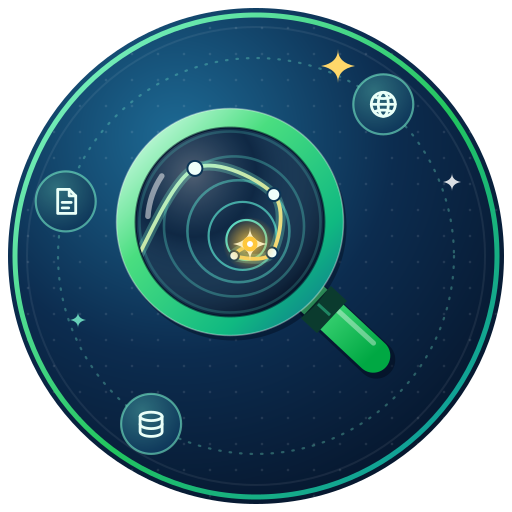

# DeepSearch: 1st Workshop on Deep Search and Research Agents for the Web

## Introduction

Welcome to DeepSearch: 1st Workshop on Deep Search and Research Agents for the Web!

Search is moving from engines to agents. Systems built on large language models (LLMs) can now plan a research question, issue dozens of searches, read and reason over what they find, and write a grounded answer or a full report. This raises questions that classic information retrieval has rarely had to answer: when should an agent search and when should it stop, how should it be trained and evaluated, how should search engines serve a client that never clicks, and how can such systems be made faithful, safe and affordable at web scale?

DeepSearch is a half-day, in-person workshop at WSDM 2027 that studies the search agent itself as a new search paradigm, from reasoning and learning to evaluation, co-design with search engines, and trust.

## Topics of Interest

The topics follow the life cycle of a deep search agent, from how it decides and learns, through how it researches and interacts with search engines, to how it is evaluated, deployed and kept safe. Topics of interest include, but are not limited to:

- **Reasoning, planning and memory for search agents**, such as query decomposition, multi-hop search, deciding when to search and when to stop, and memory management.
- **Learning search agents**, such as reinforcement learning with outcome and process rewards, synthesis of hard training queries, distillation into small models, and efficient training and inference for deployment at scale.
- **Deep research systems**, such as long-horizon exploration, report generation with faithful citations, multi-agent and multimodal research, and personalized deep research tailored to individual users and their needs.
- **Search engines for agents**, such as mining agent-issued queries, retrieval and ranking for LLM readers, agent-native search interfaces, and efficient serving of agent traffic.
- **Evaluation and benchmarks**, such as trajectory-level and report-level metrics, LLM-as-judge methods, cost-aware evaluation, and reproducible sandboxes of the web.
- **Applications of deep search agents** in web search, recommendation, e-commerce, advertising, science and healthcare, including lessons learned from industrial deployment.
- **Trust, safety and the web ecosystem**, such as hallucination and attribution, prompt injection and corpus poisoning, privacy, and the incentives of content providers.

## Submission Instructions

Submissions must be written in English, 4–8 pages (including references), and use the same template as the WSDM main conference. Position papers, negative results, new benchmarks and reports on deployed systems are especially welcome.

All submissions will be double-blind peer reviewed by at least two program committee members and judged by their relevance to the workshop, novelty, technical soundness, and potential to stimulate discussion.

Accepted papers will be published in the **WSDM 2027 Companion Proceedings**. Subject to the proceedings policy, authors of already-published work may choose a non-archival presentation.

Every accepted paper must be presented in person by at least one of its authors, either as an oral talk or as a spotlight followed by a poster. In line with the WSDM 2027 policy, there will be no remote presentations.

Submission website: <https://cmt3.research.microsoft.com/WSDM2027/Track/13/Submission/Create>. When submitting, please select **Workshop - DeepSearch Research Agents**.

## Awards

DeepSearch will select a **Best Paper Award** and a **Best Student Paper Award** from the accepted papers. The awards will be presented at the closing session of the workshop.

## Important Dates

Time zone: Anywhere on Earth (AoE)

Workshop website and CFP: October 20, 2026

Paper submission deadline: November 30, 2026

Paper notification: December 18, 2026

Workshop day: February 19, 2027

## Attendance

- When: February 19, 2027 (Hong Kong Time Zone, GMT+8); the exact time is TBD
- Where:
  - In-person participation: The workshop will be a fully in-person event held at WSDM 2027 in Hong Kong, China. The room will be announced later.
  - Online participation: In line with the WSDM 2027 policy, there will be no remote presentations.

## Invited Speakers



## Organizers



## Contact

If you have any questions, please contact us at [morin.wang@cityu.edu.hk](mailto:morin.wang@cityu.edu.hk).
